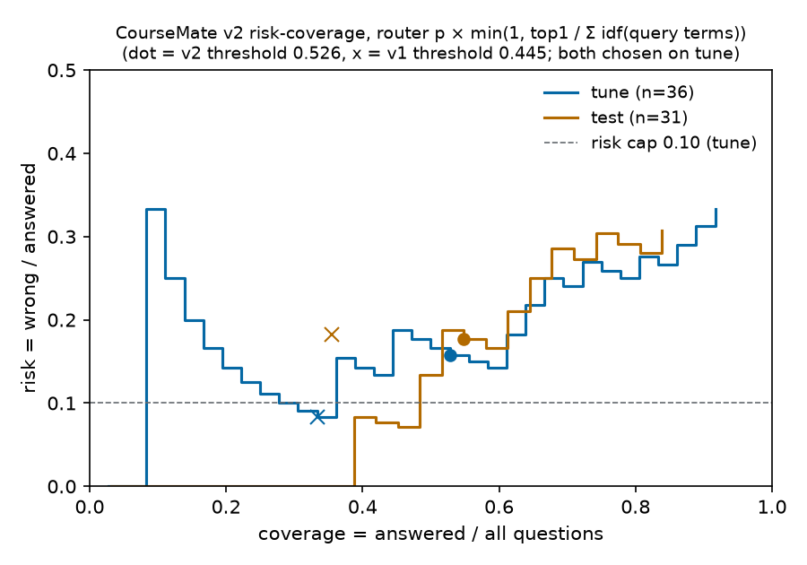

# CourseMate ML prototype: results

All numbers come from running `bash run_all.sh` in this folder; each table names the script and file it came from. Paste-ready for report sections 4 (data), 5 (methods) and 6 (evaluation).

**Circularity warning.** The 167 labelled questions in `ml/data/questions.csv` were written and labelled by one author (the same person who built the system), with gold chunks chosen from the chunk text. That makes every number here optimistic. Before the report, a second team member must label the questions independently (label and gold chunks, blind to these labels); report inter-annotator agreement (Cohen's kappa on the label, overlap on gold chunks) and rerun.

## 4. Data and preprocessing

Sources (only these): the course project page (text), 22 Canvas assignment items (JSON, due dates in UTC), the Canvas front page. Course-wide grading weights (quizzes, assignments, exams) are not in these sources and are not used anywhere.

- **Chunks** (`ml/build_corpus.py` -> `ml/data/chunks.jsonl`): 46 chunks. Course page split by section, then into windows of about 150 words (max 200) with a 20-word overlap (13-15%). Page chunk sizes in words: [73, 83, 100, 113, 138, 138, 138, 138, 138, 138, 139, 139, 139, 155]. Sections shorter than 100 words (Important Dates, Group Formation) stay whole: a deviation from the 100-200-word plan, kept so each chunk has one source label. Each Canvas item is one short chunk (17-23 words) with its due time converted to HKT (UTC+8); items with no due date say so.
- **Normalisation and tokeniser** (`ml/textnorm.py`, ported to JS): Unicode NFKC, lowercase; tokens are ASCII letter/digit runs or single Han characters, so "proposal幾時due" -> proposal / 幾 / 時 / due. Single-character tokens are kept ("Quiz 2", "Part A", "get 0"). MiniLM gets the raw text and uses its own WordPiece tokeniser.
- **Questions** (`ml/data/questions.csv`): 167 labelled questions; kinds: clean 54, codemix 28, paraphrase 46, typo 26, whatif 13. Lookup questions carry every chunk that states the answer as gold. Calc questions carry the expected item, score and stamp; what-ifs on quizzes/assignments/exams are labelled calc with expected ESCALATED ("weight not in table").
- **Split** (`ml/make_split.py`, seed 1945, frozen before any model was fitted; `run_all.sh` checks its SHA-256): 60/20/20 by question family (paraphrase/typo/code-mix variants of one question stay together), stratified by label.

| split | lookup | calc | oos | total |
|---|---|---|---|---|
| train | 70 | 16 | 14 | 100 |
| tune | 26 | 4 | 6 | 36 |
| test | 21 | 5 | 5 | 31 |

Test has only 5 calc and 5 out-of-scope questions, so per-class numbers on test move by 0.2 per question.

## 5. Methods

- **Router**: TF-IDF + logistic regression (C=10, class-balanced), 3 classes lookup / calc / oos, fitted on train only. Analyzer chosen on tune macro-F1: word1 0.810, word12 0.714, char35 0.593 -> **word1** (`ml/train_router.py`).
- **Lookup**: BM25 vs TF-IDF (word 1-gram, word 1-2-gram, char_wb 3-5-gram) vs all-MiniLM-L6-v2 embeddings (cosine). Selection rule: max tune MRR, tie -> tune Top-3 -> order bm25,word1,word12,char35,minilm. Winner on tune: **bm25**; deployed: **bm25**. MiniLM did not win, so no transformers.js download is needed; the page stays a single static file.
- **Calculator** (`ml/calc.py`): deterministic code over the Important Dates weights only (Registration 0, Proposal 2, Poster 10, Video 3, Final Report 7; total 22). Integer arithmetic in hundredths of a mark, so 18.7 is exact. A what-if on any item without a weight is ESCALATED with reason "weight not in table". No LLM is used anywhere.
- **Confidence and fallback** (`ml/pipeline.py`): deployed (v2) lookup conf = router p × min(1, top1 / Σ idf(query terms)); calc conf = router max-probability; out-of-scope always escalates. Below the threshold the answer is ESCALATED: "Please ask the TA." Threshold 0.5264, chosen on tune (see 6.3 for v1 vs v2).
- **Browser deployment**: `ml/export_model.py` writes `model.json` (router vocabulary, idf, LR coefficients, BM25 term statistics, chunk texts, threshold, weights) and inlines it into `index.html`, so the page works from file:// and on any static host with no network calls.

## 6. Evaluation

### 6.1 Lookup retrieval (`ml/eval_retrieval.py` -> `results/retrieval.json`)

Test split, lookup questions only (n = 21); 95% bootstrap CI (2000 resamples) in brackets. Top-k = any gold chunk in the top k. Recall@k = share of a question's gold chunks found in the top k. MRR = 1 / rank of first gold chunk.

| representation | tokeniser | tune MRR (selection) | Top-1 | Top-3 | R@1 | R@3 | R@5 | MRR |
|---|---|---|---|---|---|---|---|---|
| bm25 | word | 0.824 | 0.762 [0.571, 0.952] | 0.857 [0.714, 1.000] | 0.571 | 0.762 | 0.833 | 0.809 |
| word1 | word | 0.797 | 0.667 [0.476, 0.857] | 0.857 [0.714, 1.000] | 0.500 | 0.786 | 0.833 | 0.784 |
| word12 | word (1-2-gram) | 0.746 | 0.714 [0.524, 0.905] | 0.857 [0.714, 1.000] | 0.548 | 0.810 | 0.881 | 0.804 |
| char35 | sub-word chars | 0.809 | 0.429 [0.238, 0.619] | 0.952 [0.857, 1.000] | 0.333 | 0.857 | 0.905 | 0.689 |
| minilm | WordPiece | 0.607 | 0.571 [0.333, 0.762] | 0.714 [0.524, 0.905] | 0.405 | 0.571 | 0.714 | 0.670 |

Larger n: retrieval is not trained on questions, so all 117 lookup questions can also be scored (supplementary; the test split above is the primary number):

| representation | Top-1 all | Top-3 all | Top-1 clean | Top-1 paraphrase | Top-1 typo | Top-1 code-mix |
|---|---|---|---|---|---|---|
| bm25 | 0.701 [0.615, 0.786] | 0.872 [0.803, 0.932] | 0.686 (n=35) | 0.683 (n=41) | 0.619 (n=21) | 0.850 (n=20) |
| word1 | 0.684 [0.598, 0.769] | 0.872 [0.803, 0.932] | 0.657 (n=35) | 0.732 (n=41) | 0.667 (n=21) | 0.650 (n=20) |
| word12 | 0.692 [0.607, 0.778] | 0.863 [0.795, 0.923] | 0.686 (n=35) | 0.707 (n=41) | 0.571 (n=21) | 0.800 (n=20) |
| char35 | 0.615 [0.530, 0.701] | 0.872 [0.812, 0.923] | 0.629 (n=35) | 0.585 (n=41) | 0.667 (n=21) | 0.600 (n=20) |
| minilm | 0.513 [0.427, 0.598] | 0.726 [0.641, 0.803] | 0.600 (n=35) | 0.537 (n=41) | 0.476 (n=21) | 0.350 (n=20) |

MiniLM status: ran from the local Hugging Face cache.

### 6.2 Router (`ml/train_router.py` -> `results/router.json`)

| metric | value | n |
|---|---|---|
| test macro-F1 | **0.803** | 31 |
| test macro-F1, majority-class baseline | 0.269 | 31 |
| test accuracy | 0.871 | 31 |
| test per-class F1 | lookup 0.909, calc 1.000, oos 0.500 | {'lookup': 21, 'calc': 5, 'oos': 5} |
| 5-fold CV macro-F1, train+tune, family-grouped | 0.678 +- 0.086 (folds 0.681, 0.817, 0.676, 0.589, 0.628) | 136 |
| 5-fold CV majority baseline | 0.276 | 136 |

Test confusion matrix (rows = true, columns = predicted):

| | lookup | calc | oos |
|---|---|---|---|
| lookup | 20 | 0 | 1 |
| calc | 0 | 5 | 0 |
| oos | 3 | 0 | 2 |

[INFERRED] The CV mean (0.678) is well below the test figure, so the test macro-F1 is probably a favourable draw of 31 questions; the plausible range is roughly the span between the two.

### 6.3 Risk-coverage and threshold (`ml/train_router.py` -> `results/risk_coverage.png`)

Coverage = answered (SOURCED or CALCULATED) / all questions. Risk = wrong answers / answered. Wrong = lookup whose top chunk is not gold, calc with wrong item or score, or any answer to a question that should escalate. End-to-end = right answer, or escalation when escalation was expected.

Two versions of the lookup confidence, both with the same threshold rule (highest tune coverage with tune risk <= 0.1; ties -> higher threshold):

- **v1 (pre-registered)**: router p × s1/(s1+K), K = 5.927. Threshold 0.4450.
- **v2 (deployed; post-hoc: the test split had been seen once (v1) before this change)**: v1 penalised short queries, because a raw BM25 score grows with the number of query terms. Three normalised candidates were compared on TUNE only, each with its own tune-chosen threshold; the candidate with the highest tune coverage won (tie -> lower tune risk). Test was scored once, after the choice.

| v2 candidate (tune only) | threshold | tune coverage | tune risk | answered |
|---|---|---|---|---|
| router p × top1/(top1+top2) | 0.5342 | 0.167 | 0.000 | 6 |
| router p × min(1, top1 / Σ idf(query terms)) **(chosen)** | 0.6382 | 0.333 | 0.083 | 12 |
| router p | 0.9485 | 0.111 | 0.000 | 4 |

| setting | coverage | risk | answered | wrong | n | end-to-end |
|---|---|---|---|---|---|---|
| tune, no threshold | 0.917 | 0.333 | 33 | 11 | 36 | - of 36 |
| tune, v1 t=0.4450 | 0.333 | 0.083 | 12 | 1 | 36 | 18/36 |
| tune, v2 t=0.5264 | 0.528 | 0.158 | 19 | 3 | 36 | 23/36 |
| test, no threshold | 0.839 | 0.308 | 26 | 8 | 31 | - of 31 |
| test, v1 t=0.4450 (seen first) | 0.355 | 0.182 | 11 | 2 | 31 | 16/31 |
| **test, v2 t=0.5264 (post-hoc, scored once)** | 0.548 | 0.176 | 17 | 3 | 31 | 21/31 |

v2 at its threshold: every test question that should escalate did (7/7); 4 test questions still escalate as low-confidence although their top chunk is correct. **Deployed threshold 0.5264 is a team override (target 0.526), set after test numbers were seen; the rule (tune risk <= 0.1) gives 0.6382.** Test risk (0.176) is above the 0.1 tune cap; the threshold comes from 36 tune questions. Because v2 was designed after v1's test numbers were seen, the v2 test row is not a clean held-out estimate: see 6.8.

**Sample questions, v1: 3/5 as intended.** "When is the proposal due?" -> ESCALATED (low confidence), conf 0.42, not as intended (wanted SOURCED); "If I get 0 on the poster, what is my project mark?" -> CALCULATED, conf 0.99, ok; "Can you write my assignment?" -> ESCALATED (out of scope), conf 0.58, ok; "Is late submission allowed?" -> ESCALATED (low confidence), conf 0.38, not as intended (wanted SOURCED); "When is the poster link due?" -> SOURCED, conf 0.53, ok

**Sample questions, v2: 4/5 as intended.** "When is the proposal due?" -> SOURCED, conf 0.59, ok; "If I get 0 on the poster, what is my project mark?" -> CALCULATED, conf 0.99, ok; "Can you write my assignment?" -> ESCALATED (out of scope), conf 0.58, ok; "Is late submission allowed?" -> ESCALATED (low confidence), conf 0.45, not as intended (wanted SOURCED); "When is the poster link due?" -> SOURCED, conf 0.75, ok

v2 tune operating points (every 3rd candidate threshold; lowering the threshold trades risk for coverage, a team decision):

| threshold | tune coverage | tune risk | answered |
|---|---|---|---|
| 0.000 | 0.917 | 0.333 | 33 |
| 0.272 | 0.861 | 0.290 | 31 |
| 0.395 | 0.778 | 0.250 | 28 |
| 0.421 | 0.694 | 0.240 | 25 |
| 0.447 | 0.611 | 0.182 | 22 |
| 0.526 | 0.528 | 0.158 | 19 |
| 0.546 | 0.444 | 0.188 | 16 |
| 0.586 | 0.361 | 0.154 | 13 |
| 0.663 | 0.278 | 0.100 | 10 |
| 0.743 | 0.194 | 0.143 | 7 |
| 0.901 | 0.111 | 0.250 | 4 |
| 0.958 | 0.028 | 0.000 | 1 |

### 6.4 Calculator (`ml/test_calc.py`, `ml/mutate_calc.sh`)

Exact match on 15 hand-computed cases (expected values typed by hand in the test file): **15/15**. Mutation check: Poster weight changed 10 -> 11 gives 4/15 (red), restored by checksum, then green again.

### 6.5 Python-JS parity (`ml/parity.py`, `ml/mutate_parity.sh`)

The JS embedded in `index.html` reproduces the Python pipeline on 175/175 questions (all 167 labelled + edge cases) on label, top chunk, stamp, reason and calculator output. Max probability difference 2.2e-16; smallest router top1-top2 margin 0.0174. A deliberate change to the JS confidence formula turns this red (see run log).

### 6.6 Against the proposal targets

| target | result | met? | source |
|---|---|---|---|
| router macro-F1 >= 0.85 | test 0.803 (n=31); CV 0.678 | no | train_router.py |
| lookup Top-3 >= 80% (bm25) | test 85.7% [CI 71.4%-100.0%], n=21 | yes (point estimate); CI lower bound below 80% | eval_retrieval.py |
| calculator exact match >= 95% | 15/15 | yes | test_calc.py |

### 6.7 Error analysis: 5 real test failures, deployed v2 (`results/predictions.csv`)

10 of 31 test questions were not handled correctly end-to-end. Five, chosen to cover different failure types:

| id | question | true | router | stamp | top chunk | why |
|---|---|---|---|---|---|---|
| q012 | video deadline | lookup | lookup | SOURCED | page:group-formation:0 | BM25 per-term scores: Group Formation 3.04, all from 'deadline' ('register ... by the deadline'); gold chunks 2.47 and 2.52, only from 'video', because they say 'Due' rather than 'deadline'. Outcome: wrong answer shown (worst type). |
| q030 | How much is each project item worth? | lookup | lookup | SOURCED | syllabus:grading | Router says out-of-scope: 'much' and 'worth' lean out-of-scope because the train question "How much are the quizzes worth in the course grade?" is labelled out-of-scope; 'each' and 'item' are unseen. BM25 also misses (Final Report chunk first): 'worth' and 'item' never appear in the corpus, which says 'Weight' and 'Deliverable'. Outcome: wrong answer shown (worst type). |
| q036 | Can I email the report to the instructor? | lookup | oos | ESCALATED | page:submission:0 | Router sends it to out-of-scope (conf 0.73). 'email' is not in the router's training vocabulary; 'instructor' (learnt from the train out-of-scope question "When are the instructor office hours?") and the function words 'to', 'the', 'i' carry the largest out-of-scope weights. Retrieval alone found the right chunk. Outcome: escalated (out of scope). |
| q057 | How long should the conclusion be? | lookup | lookup | ESCALATED | syllabus:exam | BM25 per-term scores: Video Trailer chunk 5.60 from 'long' 1.93, 'should' 1.72, 'be' 1.21, 'the' 0.74; gold Final Report chunk 2.83, of which 'conclusion' 2.12. Common words outvote the one content word. Outcome: escalated as low confidence: a safe miss. |
| q076 | Where do we upload the video? | lookup | lookup | SOURCED | page:submission:0 | Retrieved the Submission chunk, which talks about the video link but not where to upload; gold is the Video Trailer chunk ('Upload the video to a ShareDrive'). Partly a gold-labelling judgment call. Outcome: wrong answer shown (worst type). |

Pattern: answered-but-wrong cases come from BM25 word overlap with the wrong section; router misses come from cue words learnt from a small training set ('instructor', 'worth'); the remaining failures are safe escalations below the threshold.

### 6.8 Fresh holdout (to do: a teammate)

Every split here was written by the system's author, and v2 was designed after v1's test numbers were seen. For a clean estimate, a teammate who has not seen `questions.csv` or these results should write 30 new questions (roughly 18 lookup, 6 calc, 6 out-of-scope; include paraphrases, typos and Cantonese-English mix) in `ml/data/holdout.csv`, copied from `ml/data/holdout_template.csv` (columns q, label, gold_chunk_ids; gold ids from `ml/data/chunks.jsonl`). Then run `.venv/bin/python eval_holdout.py` (from `ml/`): it scores the deployed model once, with no refitting. Report that number as the headline and these numbers as development results.

## Source conflicts found in the data

1. **Poster due date.** Canvas lists *Poster Presentation* due Mon 30 Nov 2026, 23:59 HKT (`canvas_assignments.json`, 2026-11-30T15:59:59Z). The course project page says the poster link is due "One day before your assigned Poster Presentation Session" (Team 9 presents Nov 20). Both are kept as separate chunks with their own source labels; the page shows a conflict note on either. Ask the TA which is binding.
2. **Final Report points.** Canvas shows "Final Report (with Video Trailer Link)" as 10 points; the course page weights Final Report 7 and Video Trailer 3. The calculator uses the course page.
3. **Video length.** The page says "approximately 1-2 minutes" and also "Approximately 2 minutes; recommended range: 1.5-2.5 minutes".
4. The Important Dates table leaves the Final Report due date blank; only the Submission section and Canvas give Nov 30.

## Limitations

- Calculator takes the first number in the question: "poster is worth 10%, what if I get 0" computes a score of 10, and "8 out of 10" computes 8.
- Calc what-if questions reuse a few templates across splits, so the router's 5/5 on test calc questions is optimistic.
- Self-written, single-annotator test set (see the warning at the top); no inter-annotator agreement yet.
- Small n: test has 31 questions (21 lookups, 5 calc, 5 out-of-scope). CIs are wide; tune (36) is too small for a stable threshold.
- The corpus is 46 chunks from three documents; questions whose answers are not in them (midterm date, quiz weights) can only be escalated.
- Lexical retrieval does not know synonyms ("worth" vs "weight", "deadline" vs "due"); MiniLM did worse here, possibly because Canvas chunks are short templated strings.
- Calculator handles one item and one whole-number score per question; it does not parse multi-item what-ifs or typos in item names ("postr").
- The old hand-built router answered quiz due dates with Ask TA; now they are lookups, because Canvas gives the dates.
- Not evaluated with real students; no usability data.
